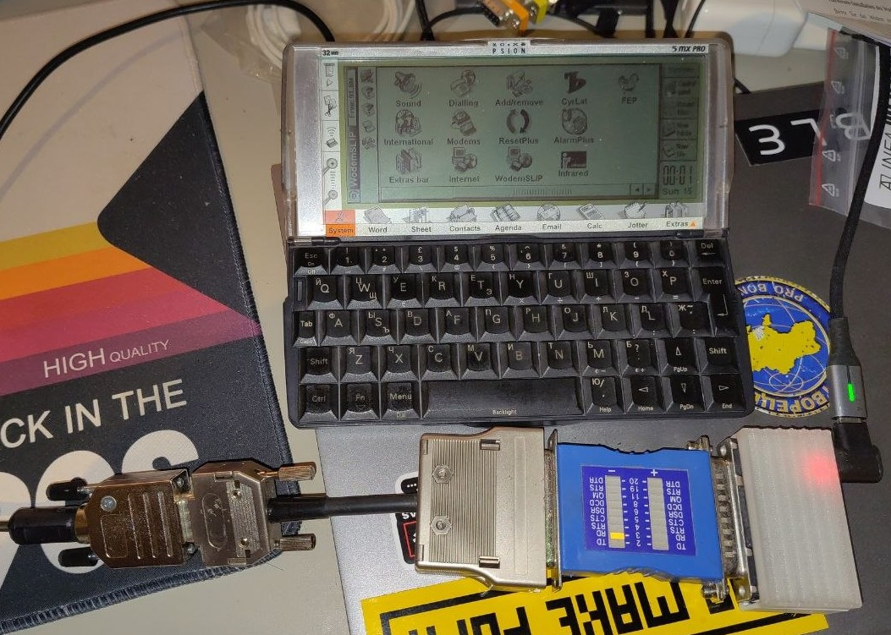
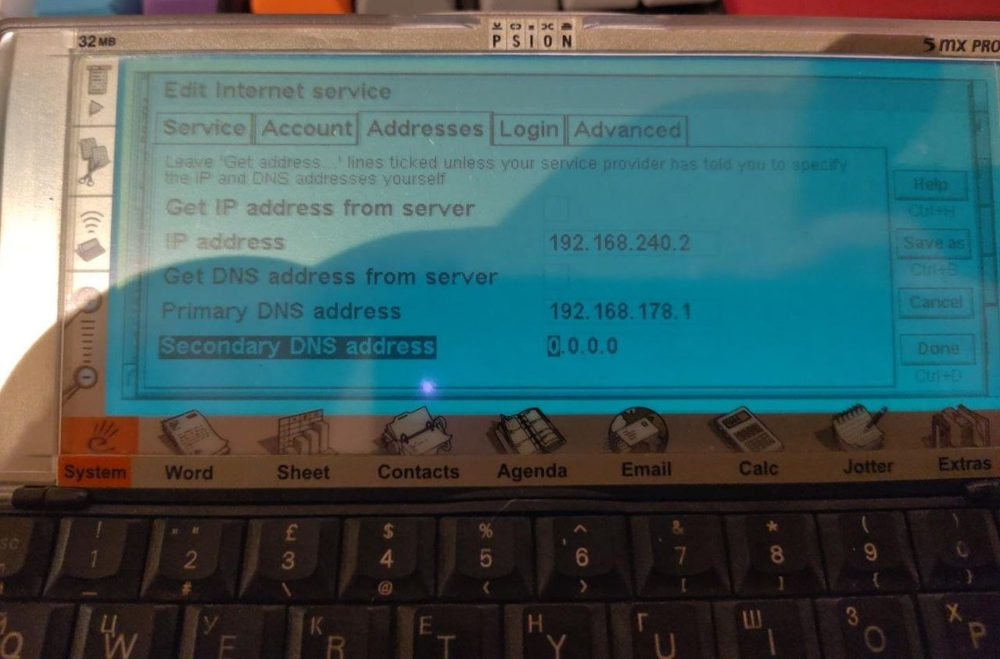
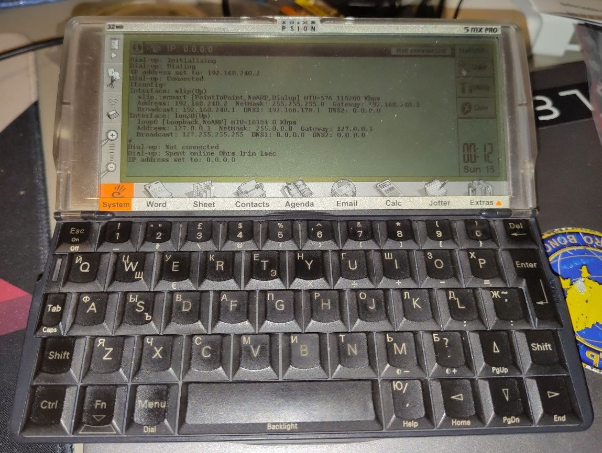
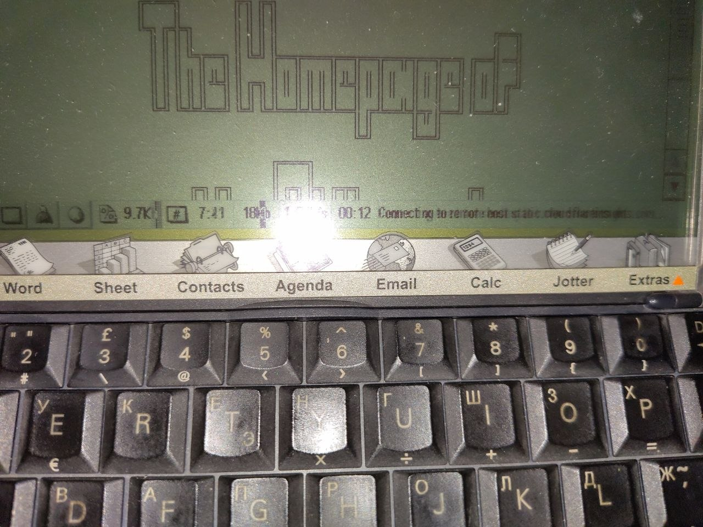

# Psion-WodemSLIP

Connect a Psion running **EPOC ER5** to Wi-Fi through its serial port using a **Wodem** adapter.

**Initial release: 0.4.5** · **Maintainer: [ExPLIT](https://github.com/explit28)**



*The working hardware setup. The blue RS-232 tester shown in the photo is optional and is not required for the connection.*

## What it does

WodemSLIP provides a serial SLIP network driver, a native System Control panel applet and a `.sis` installer. The Psion sends IP packets over RS-232 to the Wodem, which connects to your wireless network. Internet applications use the resulting connection through EPOC's TCP/IP stack.

- Native **WodemSLIP** Control panel entry with the EPOC Internet icon.
- Selectable SLIP Internet connection profiles.
- Static IP, gateway and DNS configuration.
- Serial transmit flow control and receive-error recovery.

The hardware setup used for development is a **Psion 5mx Pro with 32 MB RAM running EPOC ER5**. Other models and ROM versions are not yet verified.

## Hardware and useful links

Use the following cable chain for the tested setup:

**Psion → Serial cable → Null-modem adapter → DB9-to-DB25 adapter → Wodem**

The null-modem adapter provides the serial crossover; the DB9-to-DB25 adapter matches the connector sizes. Supply the Wodem with its required external power. You also need a way to transfer the installer to the Psion.

Configure the Wodem's Wi-Fi settings over Telnet, either from a **Linux machine** or directly on the **Psion using Mocha Telnet**. See [Wodem configuration](#configure-the-wodem-over-telnet).

- **[Wodem product page — Alinea Computer / Amiga Shop](https://www.amiga-shop.net/Amiga-Hardware/Klassische-Amiga-Hardware/Wodem-WLAN-fuer-jeden-Amiga::1304.html)** — hardware, product photographs and power options.
- **[Wodem hardware design](https://gitlab.com/rwahler1/kicad/Amiga_Wodem)** — KiCad project.
- **[ESP SLIP Router firmware](https://github.com/martin-ger/esp_slip_router)** — firmware used by the Wodem.
- **[Wodem enclosure](https://www.thingiverse.com/thing:6257091)** — 3D-printable case.
- **[Psion Series 5 / 5mx overview](https://en.wikipedia.org/wiki/Psion_Series_5)** and **[Psion photo gallery](https://commons.wikimedia.org/wiki/Category:Psion_Series_5)**.

## Installation

**[Download WodemSLIP-0.4.5.sis](https://github.com/explit28/Psion-WodemSLIP/releases/download/0.4.5/WodemSLIP-0.4.5.sis)** from the [0.4.5 release](https://github.com/explit28/Psion-WodemSLIP/releases/tag/0.4.5), or [build from source](#building-from-source).

1. Back up `C:\System\Libs\SLIP.NIF`, any existing WodemSLIP applet files and `C:\System\Data\TCPIP.INI`.
2. Disconnect the network and close Internet applications and the Control panel.
3. Transfer the SIS to the Psion and open it in the System file manager.
4. At the TCP/IP settings question, choose **Yes** to install the supplied defaults, or **No** to preserve an existing working `TCPIP.INI`. A template is installed in either case.
5. Close programs and perform a **normal soft reset** to unload any previously loaded driver.
6. Create a connection under **Control panel → WodemSLIP → New → Standard settings**.

Do not perform a hard reset. The installed quick-start guide is at `C:\System\WodemSLIP\QUICKSTART.TXT`. See the [installation guide](docs/INSTALL.md) for details.

## Connection settings

Create a profile named **Wodem SLIP**, with these settings:

| Profile setting | Value |
|---|---|
| Connection type | Direct |
| Manual login | Off |
| Login script / display window | Off |
| PPP extensions / callback | Off |
| Get IP address from server | Off |
| Local IP address | `192.168.240.2` |
| Automatic DNS | Off; enter the DNS server for your LAN |



*Profile address settings: the Psion uses `192.168.240.2`. The DNS address shown is for this particular LAN; use the DNS server for your own network.*

**The active SLIP addresses come from `C:\System\Data\TCPIP.INI`. Entering an address in the profile alone is insufficient.** The supplied configuration includes both `[slip]` and `[slip::ecuart]` sections.

| Network setting | Supplied default |
|---|---|
| Psion address | `192.168.240.2` |
| Wodem peer and default gateway | `192.168.240.1` |
| Netmask | `255.255.255.0` |
| DNS server | `192.168.178.1` — change this for your LAN |
| Wodem management console | TCP port `7777` |

The DNS default is from a FritzBox network; it is not universal. Change `ns1` in **both** SLIP sections if your network uses another DNS server. See [the configuration file](config/TCPIP.INI).

### Serial connection

Under **Control panel → Modems**, select the direct cable entry:

- Match the Wodem's baudrate; the development setup uses **115200 baud, 8 data bits, no parity, 1 stop bit**.
- Match hardware flow control to the actual firmware and connected handshake lines. RTS/CTS requires support at both ends.
- Keep **XON/XOFF off** for this binary SLIP connection.
- Disable terminal detection if the cable does not supply the required DSR/DTR signals.

**Switch off the Psion desktop/remote link before starting SLIP.** Close raw serial terminal programs too: they compete for the same serial port.

## Configure the Wodem over Telnet

The Wodem's configuration console uses **TCP port 7777**. With the supplied SLIP addresses, the Wodem is **`192.168.240.1`** and the attached computer is **`192.168.240.2`**. Telnet runs over that IP connection; it is not a raw serial terminal session. Local access to the console does not require an Internet connection.

### Option 1: from Linux

Connect the Wodem to a Linux machine through a suitable **USB-to-RS-232 adapter** and matching serial adapters. Establish the local SLIP link, then open Telnet. The following example follows the [firmware's Linux setup](https://github.com/martin-ger/esp_slip_router#usage-as-sta), using `/dev/ttyUSB0` and 115200 baud. Substitute your device and the Wodem's configured baudrate.

Run this in one terminal and leave it running:

```bash
sudo slattach -L -p slip -s 115200 /dev/ttyUSB0
```

In another terminal, configure the resulting interface and connect:

```bash
sudo ifconfig sl0 192.168.240.2 pointopoint 192.168.240.1 up mtu 1500
telnet 192.168.240.1 7777
```

Use the actual SLIP interface name if it is not `sl0`. On Debian/Ubuntu, `slattach` and `ifconfig` are supplied by `net-tools`; a Telnet client must also be installed. This local configuration session does not require changing the Linux default route or DNS settings. After configuration, close Telnet and stop `slattach` with Ctrl+C before moving the Wodem back to the Psion cable chain. Firmware builds requiring hardware flow control may need different serial handling; see the firmware documentation.

### Option 2: directly from the Psion

Install WodemSLIP, configure the direct-cable profile and start the SLIP connection as described above. Keep the Psion desktop/remote link switched off. Then create a **TCP/IP connection in Mocha Telnet**:

| Mocha Telnet setting | Value |
|---|---|
| Host | `192.168.240.1` |
| Port | `7777` |
| Terminal type | VT100 |
| Local echo | Enable if your typing is not visible; disable if characters appear twice |

The Wodem console can be reached over this local SLIP link before its Wi-Fi connection has been configured.

### Set the Wi-Fi network

At the Wodem's `CMD>` prompt, use the following firmware commands, replacing the placeholders with your network details:

```text
set ssid YOUR_WIFI_SSID
set password YOUR_WIFI_PASSWORD
set use_ap 0
save
reset
```

`set use_ap 0` selects station mode, so the Wodem joins your existing Wi-Fi network. For spaces or special characters, use the [escaping described in the firmware documentation](https://github.com/martin-ger/esp_slip_router#usage-as-sta). After the restart, reconnect and enter `show` to inspect the configuration and connection status. The `reset` command restarts the Wodem and interrupts the Telnet session.

## Test the connection

1. Connect using the **Wodem SLIP** profile.
2. In an IP utility such as NetUtils, verify that the active SLIP address is `192.168.240.2`, not `0.0.0.0`.

   

   *The interface output shows the configured Psion address `192.168.240.2`, gateway `192.168.240.1` and the DNS server for this LAN. The final log lines show a later disconnection, after which the address returns to `0.0.0.0`.*

3. Ping `192.168.240.1` to test the local connection to the Wodem.
4. Open this small HTTP page in the Psion browser:

   **[CERN — The World Wide Web project](http://info.cern.ch/hypertext/WWW/TheProject.html)**



*Opera displaying a web page on the Psion.*

For Wodem management, use a **TCP/IP Telnet client** such as Mocha Telnet with host **`192.168.240.1`** and port **`7777`**. At the firmware prompt, `show` displays status and configuration. A raw serial terminal is a different connection type and cannot be used simultaneously with SLIP.

Successful networking does not make a historical Psion browser compatible with modern TLS, JavaScript or large websites. Start with simple HTTP pages. For connection problems, see [Troubleshooting](docs/TROUBLESHOOTING.md).

## Building from source

This repository contains scripts, configuration, tests and documentation. The build requires the exact EPOC ER5 SDK inputs and the external `xmakesis.pl` tool described in [Development](docs/DEVELOPMENT.md). SDK binaries are not bundled in the source repository.

```bash
python3 -m venv .venv
. .venv/bin/activate
python -m pip install -r requirements.txt
python build.py --sdk-root /path/to/Cpp --makesis /path/to/xmakesis.pl --test
```

Output: **`dist/WodemSLIP-0.4.5.sis`**.

## Documentation

- [Installation, profile setup and removal](docs/INSTALL.md)
- [Troubleshooting](docs/TROUBLESHOOTING.md)
- [Driver and configuration design](docs/DESIGN.md)
- [Build requirements and verification](docs/DEVELOPMENT.md)
- [Third-party components](THIRD_PARTY.md)

## Credits and license

Project by **ExPLIT** — GitHub: **[explit28](https://github.com/explit28)**. Setup, configuration and browser photographs provided by ExPLIT.

Thanks to Alinea Computer for the Wodem hardware, martin-ger for ESP SLIP Router, and the authors of the EPOC SDK and build tools.

Original project scripts and documentation are covered by the [MIT license](LICENSE). Symbian SDK-derived binaries, resources, icons and third-party photographs retain their respective terms. See [THIRD_PARTY.md](THIRD_PARTY.md) for scope and redistribution information.
